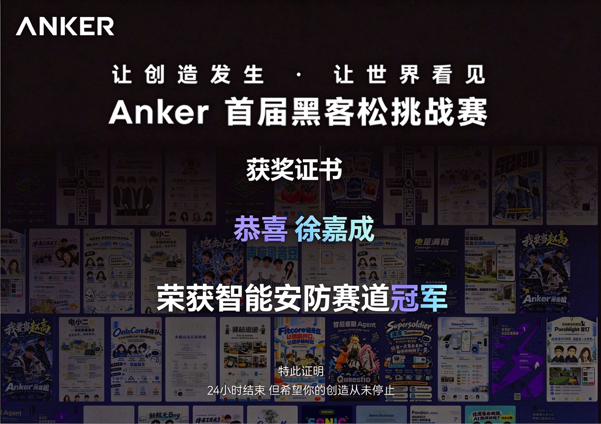

[English](README.md)

# 你好，我是 Harry Xu · 徐嘉成

**独立开发者 · AI 应用与桌面工具 · 欢迎项目合作**

把具体问题做成可用的工具，从 Agent 应用逐步深入底层系统与视觉智能。

## 学习路线

**AI Agent → AI Infra → Computer Vision → World Models**

从 Agent 应用与工具集成出发，逐步深入模型服务、推理与部署，再拓展到视觉感知；World Models 是长期希望探索的方向。这是我的学习路径，当前项目实践主要集中在 Agent 应用集成与后端工程。

## 正在开发

**[ScreenDeck](https://github.com/SUertee/screen-deck)** — 以任务为中心的本地 AI 工作台，连接 Codex / OpenCode，串联任务规划、执行、人工验收与知识复用。  
React · Electron · TypeScript｜开发预览版

## 🏆 已取得的成果

**2026 Anker 首届黑客松挑战赛 · 智能安防赛道冠军**

首次参加黑客松，担任四人团队队长，负责项目管理、后端开发与跨模块联调。团队作品 **[ParTrace Vision · 驿站追迹](https://github.com/SUertee/partrace-vision)** 是面向驿站管理员的 AI 事件溯源助手，结合录像、视觉分析与自然语言查询。

查看获奖证书

## 合作与联系

欢迎交流 AI 工具、Agent 工作流与小型产品共创。我可以参与需求拆解、后端 / API 开发、全栈原型与项目推进。

[邮箱](mailto:suerte.668@gmail.com) · [LinkedIn](https://www.linkedin.com/in/jiacheng-xu-12316424b/)
